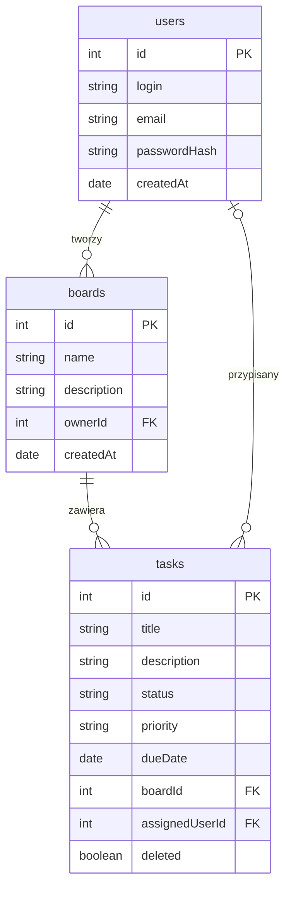

# Opis danych – TaskBoard

## Użytkownik

Użytkownik to osoba korzystająca z aplikacji TaskBoard.

| Informacja       | Przykład                                        |
| ---------------- | ----------------------------------------------- |
| ID               | 1                                               |
| Login            | maksym                                          |
| Email            | [maksym@example.com](mailto:maksym@example.com) |
| Hasło (hash)     | hash_hasla                                      |
| Data rejestracji | 2026-11-05                                      |

Hasło użytkownika powinno być przechowywane jako bezpieczny hash, a nie jako zwykły tekst.

## Tablica

Tablica służy do organizowania zadań użytkownika.

| Informacja      | Przykład             |
| --------------- | -------------------- |
| ID              | 1                    |
| Nazwa           | Projekt szkolny      |
| Opis            | Zadania do wykonania |
| ID właściciela  | 1                    |
| Data utworzenia | 2026-11-05           |

## Zadanie

Zadanie opisuje czynność do wykonania na tablicy.

| Informacja                  | Przykład                     |
| --------------------------- | ---------------------------- |
| ID                          | 1                            |
| Tytuł                       | Uzupełnić README             |
| Opis                        | Dodać informacje o projekcie |
| Status                      | w_trakcie                    |
| Priorytet                   | wysoki                       |
| Termin                      | 2026-11-10                   |
| ID tablicy                  | 1                            |
| ID przypisanego użytkownika | 1                            |
| Usunięte                    | false                        |

## Powiązania między danymi

Jeden użytkownik może utworzyć wiele tablic, ale każda tablica ma jednego właściciela.

Jedna tablica może zawierać wiele zadań, ale każde zadanie należy do jednej tablicy.

Jednemu użytkownikowi można przypisać wiele zadań, a każde zadanie może mieć jednego przypisanego użytkownika lub nie mieć go wcale.

## Przykład zadania w JSON

```json
{
  "id": 1,
  "title": "Uzupełnić README",
  "description": "Dodać informacje o projekcie",
  "status": "w_trakcie",
  "priority": "wysoki",
  "dueDate": "2026-11-10",
  "boardId": 1,
  "assignedUserId": 1,
  "deleted": false
}
```

## Wstępny diagram ERD


